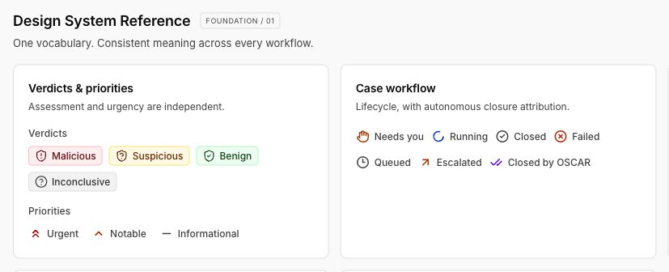
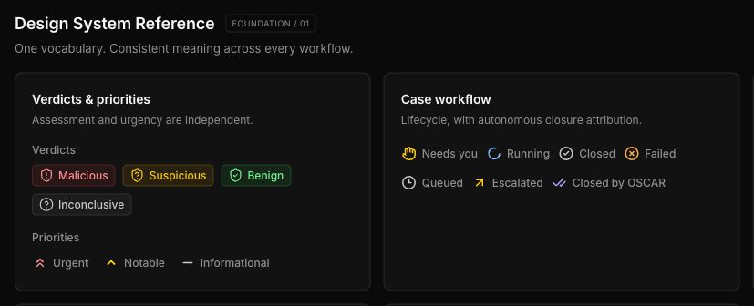

# Priority and workflow indicator refinement

> Historical design/validation record. For current routes, file locations and checks, see [platform structure](platform-structure.md).

Reviewed and verified October 27, 2026, using the saved semantic-refinement screenshots and the live `/design-preview` at 100% browser zoom (1280 CSS pixels wide; Retina device pixel ratio 2).

## Changes

The priority and workflow treatments alone now use 16 × 16px Lucide outlines, 2.25 stroke width, `flex: 0 0 16px`, a 6px icon/label gap, and 12px Medium neutral labels. Backgrounds remain transparent. Both the table and reference call the same existing semantic components and registry.

| Indicator ink token                  | Light       | Dark                                               |
| ------------------------------------ | ----------- | -------------------------------------------------- |
| `--indicator-danger-foreground`      | red-700     | existing semantic danger foreground: red-300       |
| `--indicator-warning-foreground`     | amber-700   | existing semantic warning foreground: amber-300    |
| `--indicator-information-foreground` | blue-700    | existing semantic information foreground: blue-300 |
| `--indicator-failure-foreground`     | orange-700  | existing semantic failure foreground: orange-300   |
| `--indicator-neutral-foreground`     | neutral-600 | existing semantic neutral foreground: neutral-300  |
| `--indicator-agent-foreground`       | violet-700  | existing semantic agent foreground: violet-300     |

These foreground tokens are scoped to unboxed indicators, independently of verdict foregrounds. Color remains on the icon to preserve the calm table. Labels and distinct shapes provide recognition without color alone: double chevrons for Urgent, a single chevron for Notable, and a minus for Informational; hand for Needs you, loader-circle for Running, arrow-up-right for Escalated, circle-x for Failed, check-circle-2 for Closed, check-check for Closed by OSCAR, and clock-3 for Queued.

The shared Badge's opt-in compact size already rendered at 16px. No competing size classes or SVG shrinking were found. The previous page-wide 1.75 stroke and 5px gap were the remaining scanability issues. Filled badges retain their original 1.75 stroke, 5px gap, colors, backgrounds, borders, and dimensions.

## Validation

- Actual rendered SVG dimensions: 16 × 16px for every priority/workflow indicator.
- Stroke: 2.25; SVG fill: none; flex shrink: 0; label: 12px / weight 500; gap: 6px.
- All ten states checked across 26 rendered table/reference instances per theme.
- Icon contrast: minimum **5.05:1 light**, **9.33:1 dark** against composited rendered surfaces.
- Label contrast: minimum **7.80:1 light**, **6.91:1 dark**.
- Dark icon colors match the previous semantic foregrounds exactly; no increased saturation or solid fills.
- All filled badge computed styles match their before-change snapshots in both themes, including all verdict badges.
- Compact rows remain 64px; the reference retains six cards; no horizontal table overflow.
- Browser zoom scale and root CSS zoom: 1; no browser warnings or errors.
- TypeScript, ESLint, all 16 data/semantic tests, and production build passed. An initial typecheck encountered stale generated types for the previously removed `/dashboard` route; the existing build regenerated route types and the subsequent check passed.

Rendered CSS colors were collected through the browser and converted from CSS Lab (D50) to sRGB (D65), with ancestor surface compositing and WCAG relative luminance calculations. Raw readings and results are saved in `indicator-contrast-validation.json`. The existing browser check now also asserts icon contrast, width/height, stroke, fill, shrinking, font weight and spacing.

Only production styling changed in `app/design-preview/preview.css`. `scripts/preview-browser-check.mjs` gained the targeted regression assertions. Components, registry, shared shadcn defaults, layout, cards, charts, typography, density, dependencies and verdict treatments were preserved.

## Visual comparison at 100%

Palette reference: [Tailwind colors](https://tailwindcss.com/docs/colors). Color conversion reference: [CSS Color 4 sample conversion code](https://www.w3.org/TR/css-color-4/#color-conversion-code).
