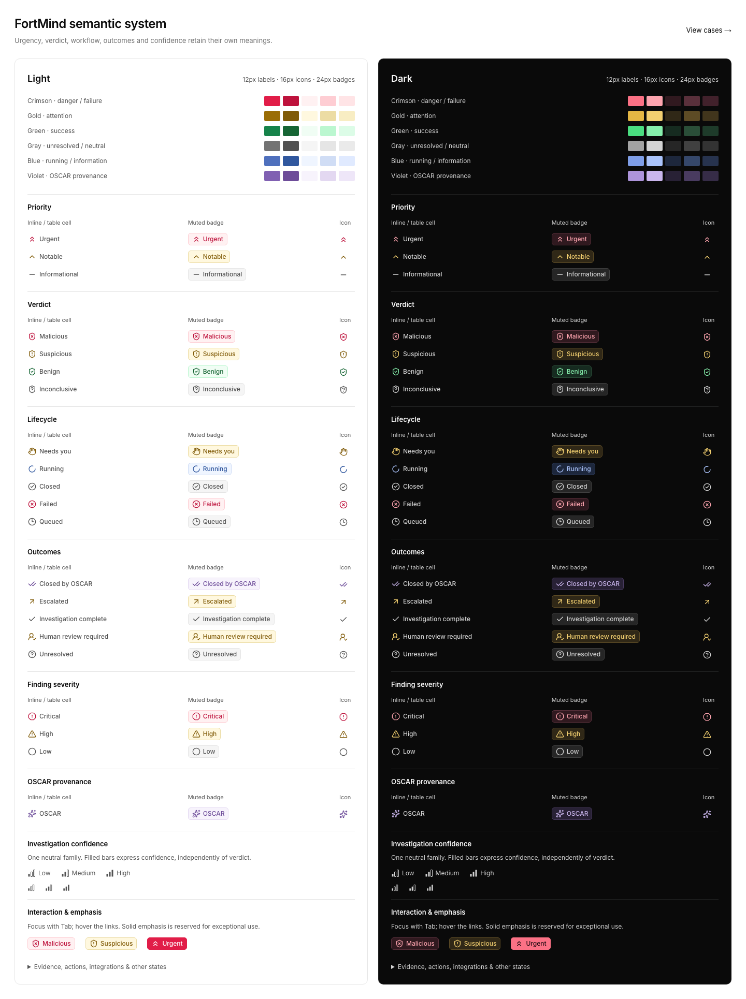

> Current semantic presentation (2026-11-06): [design-foundation.md](design-foundation.md#semantic-indicators-6-november-refinement). It replaces the historical palette, badge styling and icon choices below. `app/globals.css` and `lib/semantic-states.ts` are the current source of truth.

# FortMind semantic design system

> The state registry remains applicable. Preview routes/components and captures below describe an earlier design audit; see [platform-structure.md](platform-structure.md) and [css-cleanup.md](css-cleanup.md) for the current implementation.

Finalized 2026-11-04 as a historical design audit. The current application keeps a Neutral canvas and the FortMind blue primary while preserving fixture data, state meanings, and Inter typography.

## Preview

Open `/design-system/semantics` in development for the paired light/dark reference. The existing `/design` entry point consumes the same component. `/design-system/colors` remains the source-driven color inspector. The two `/design-system/*` audit routes return 404 in production.

## Color roles

Only `app/globals.css` authors semantic color values. Each family has six roles: base/solid for charts and exceptional emphasis, `-foreground` for readable text and meaningful icons, `-muted` for subtle surfaces, `-border` for decorative boundaries, `-accent` for interaction, and `-solid-foreground` for text on a solid fill. `@theme inline` exposes matching Tailwind utilities. Use `bg-danger-muted text-danger-foreground border-danger-border`; light/dark differences come from variables. Do not put palette literals or theme overrides in product components.

The solid foreground is explicitly separate from readable foreground-on-muted; using white indiscriminately on dark-theme solids would fail contrast. Product-role `--semantic-*` aliases resolve to the canonical palette. The failure tone uses danger without changing its business meaning.

Crimson uses a red/rose direction, while warning uses a golden yellow direction. Their different hues, distinct icons, and explicit labels separate Malicious from Suspicious and Urgent from Notable. Green and gray retain their established roles. OSCAR uses FortMind brand blue; escalation keeps a distinct violet cue. Completion and confidence remain neutral.

### Light HEX palette

| Family | Solid | Text / icon | Muted fill | Border | Hover | Solid text |
| --- | --- | --- | --- | --- | --- | --- |
| danger | #E11D48 | #BE123C | #FFF1F2 | #FECDD3 | #FFE4E6 | #FFFFFF |
| warning | #9A6D06 | #805B08 | #FFF8DF | #ECDCA4 | #F8EDC3 | #FFFFFF |
| success | #16834A | #166534 | #F0FDF4 | #BBF7D0 | #DCFCE7 | #FFFFFF |
| neutral | #737373 | #525252 | #F5F5F5 | #E5E5E5 | #EAEAEA | #FFFFFF |
| info | #4F70BD | #30579E | #EFF5FF | #D0DDF5 | #E0EAFF | #FFFFFF |
| oscar | FortMind primary | info foreground | info muted | info border | info accent | primary foreground |
| escalation | #8060B2 | #6D4C99 | #F7F3FC | #E3D8F1 | #EEE6F8 | #FFFFFF |

### Dark HEX palette

| Family | Solid | Text / icon | Muted fill | Border | Hover | Solid text |
| --- | --- | --- | --- | --- | --- | --- |
| danger | #FB7185 | #FDA4AF | #30191F | #59303B | #41212B | #200B11 |
| warning | #E4B744 | #F2CF70 | #302817 | #5D4B25 | #41351C | #211B0B |
| success | #4ADE80 | #86EFAC | #162B20 | #2A4E38 | #1E3B2A | #092013 |
| neutral | #A3A3A3 | #D4D4D4 | #262626 | #404040 | #333333 | #171717 |
| info | #7F9EE7 | #AAC3FA | #1D273C | #35476A | #27334E | #101B32 |
| oscar | FortMind primary | info foreground | info muted | info border | info accent | primary foreground |
| escalation | #AD94DA | #CAB6ED | #282135 | #493B60 | #362C47 | #1C122B |

## Icon language and rationale

All product state icons are installed Lucide exports except the reusable confidence-bar SVG. Semantic badges use 16px icons, 2px strokes, 12px medium labels, 24px height, 5px corners, and a 5px gap. Inline/table states use a 6px gap and transparent surfaces. Display headings may scale an icon with their typography.

- Priority: double upward chevrons for Urgent, one chevron for Notable, and a neutral minus for Informational. Direction and repetition express urgency without borrowing the confidence bars.
- Verdict: ShieldX for Malicious, ShieldAlert for Suspicious, ShieldCheck for Benign, ShieldQuestion for Inconclusive. Shared shield silhouettes establish the category; the internal mark distinguishes the verdict in monochrome.
- Lifecycle: Hand requests intervention, LoaderCircle communicates active work, CheckCircle2 marks closure, CircleX marks a processing failure, Clock3 marks queued work. Closed remains neutral because it does not imply benign.
- Outcomes: CheckCheck identifies autonomous closure; ArrowUpRight indicates escalation; Check means investigation complete; UserRoundCheck identifies required human review; CircleHelp marks an unresolved question. Escalated remains supported in legacy CaseStatus records without redefining backend values.
- Confidence: three ascending bar slots, with one/two/three active fills for Low/Medium/High. Inactive slots retain neutral outlines. Both fill count and height are visible at 14–16px. A level is supplied explicitly; the component never infers policy thresholds from percentages.
- OSCAR: Sparkles is reserved for automated provenance/assessment. Brand blue does not override a verdict's own color. Investigation complete remains neutral even when OSCAR performed the work.
- Finding severity: OctagonAlert for Critical, TriangleAlert for High, Circle for Low. Severity stays separate from case urgency, verdict and confidence.

### Complete state registry

#### Verdicts

| State | Tone | Icon | Meaning |
| --- | --- | --- | --- |
| Malicious | danger | shield-x | Evidence supports malicious activity. |
| Suspicious | warning | shield-alert | Activity warrants further analyst assessment. |
| Benign | positive | shield-check | Evidence supports legitimate or expected activity. |
| Inconclusive | neutral | shield-question | Evidence does not establish a verdict; this is not a severity level. |

#### Priorities

| State | Tone | Icon | Meaning |
| --- | --- | --- | --- |
| Urgent | danger | chevrons-up | Requires the most immediate review, independently of verdict. |
| Notable | warning | chevron-up | Requires prioritized review, independently of verdict. |
| Informational | neutral | minus | Informational urgency; no positive or negative assessment is implied. |

#### Workflow

| State | Tone | Icon | Meaning |
| --- | --- | --- | --- |
| Needs you | warning | hand | An analyst decision or intervention is required. |
| Running | information | loader-circle | The investigation is actively processing. |
| Closed | neutral | check-circle-2 | The workflow is closed; this does not imply a benign verdict. |
| Failed | failure | circle-x | Investigation processing failed; this is not a malicious verdict. |
| Queued | neutral | clock-3 | The investigation is waiting to start. |

#### Outcomes

| State | Tone | Icon | Meaning |
| --- | --- | --- | --- |
| Closed by OSCAR | agent | check-check | A closed case with autonomous OSCAR attribution; not a separate backend lifecycle. |
| Escalated | warning | arrow-up-right | The case was referred for further attention. |
| Investigation complete | neutral | check | The investigation finished; the case may still require an analyst decision. |
| Human review required | warning | user-round-check | An analyst must review the assessment before a decision is made. |
| Unresolved | neutral | circle-help | A question remains open; no severity or adverse verdict is implied. |

#### Severity

| State | Tone | Icon | Meaning |
| --- | --- | --- | --- |
| Critical | danger | octagon-alert | Critical finding severity; independent of the case verdict and confidence. |
| High | warning | triangle-alert | High finding severity; independent of the case verdict and confidence. |
| Low | neutral | circle | Low finding severity; this does not establish a benign verdict. |

#### OSCAR

| State | Tone | Icon | Meaning |
| --- | --- | --- | --- |
| OSCAR | agent | sparkles | OSCAR attribution identifies automated provenance, not a security verdict. |

#### Evidence

| State | Tone | Icon | Meaning |
| --- | --- | --- | --- |
| OK | positive | check | Evidence collection completed successfully. |
| Error | failure | circle-x | Evidence collection encountered a processing error. |
| Timed out | warning | clock-alert | Evidence collection exceeded its time limit and needs attention. |
| Skipped | neutral | skip-forward | Collection was intentionally omitted; no failure or success is implied. |

#### Actions

| State | Tone | Icon | Meaning |
| --- | --- | --- | --- |
| Proposed | neutral | file-clock | An action has been drafted and awaits a decision. |
| Approved | positive | check | An action has been authorized. |
| Rejected | neutral | x | The proposed action was declined; this is a decision, not a processing error. |
| Done | positive | check-check | The action completed successfully. |
| Pending | neutral | clock-3 | An action is awaiting execution or completion. |

#### Integrations

| State | Tone | Icon | Meaning |
| --- | --- | --- | --- |
| Connected | positive | plug-zap | The integration connection is established. |
| Not connected | neutral | plug | No connection is configured or established; no error is implied. |
| Testing | information | loader-circle | Connection validation is in progress. |
| Error | failure | circle-alert | The integration encountered a system or connection error. |
| Key expired | warning | key-round | The credential has expired and requires attention. |
| Key accepted | positive | key-round | The supplied credential was accepted. |

#### Hypotheses

| State | Tone | Icon | Meaning |
| --- | --- | --- | --- |
| Confirmed | positive | check | Evidence supports the hypothesis; this does not imply a benign verdict. |
| Refuted | neutral | x | Evidence does not support the hypothesis; refutation is not a failure. |
| Inconclusive | neutral | circle-help | Available evidence cannot confirm or refute the hypothesis. |
| Primary | agent | sparkles | OSCAR's primary investigation hypothesis. |

#### Assignment

| State | Tone | Icon | Meaning |
| --- | --- | --- | --- |
| Anyone | neutral | users-round | Include cases regardless of assignment. |
| Assigned to me | neutral | user-round-check | Cases assigned to the current analyst. |
| Unassigned | neutral | user-round | No analyst owns the case; this is not a security severity. |
| Other assigned users | neutral | user-round | Cases assigned to other analysts. |

#### Phases

| State | Tone | Icon | Meaning |
| --- | --- | --- | --- |
| Completed | neutral | check | This investigation phase has completed. |
| Active | information | loader-circle | This investigation phase is processing. |
| Pending | neutral | circle | This investigation phase has not started. |
| Failed | failure | circle-x | This phase encountered a processing failure. |

#### Action kinds

| State | Tone | Icon | Meaning |
| --- | --- | --- | --- |
| Containment | neutral | shield | An action intended to limit exposure; no approval or outcome is implied. |
| Recommended | neutral | lightbulb | A suggested action; no approval or outcome is implied. |

## Reuse and ownership

- `app/globals.css`: the six palettes, theme-aware Tailwind mappings, tone aliases, badge/inline/solid recipes, interaction colors, confidence fills, and internal preview styles. Portals inherit the same global colors.
- `lib/semantic-states.ts`: icons, labels, meanings and tones for verdicts, priorities, lifecycle, outcomes, severity, OSCAR, evidence, actions, integrations, hypotheses, assignment and phases; explicit confidence bar counts.
- `components/fortmind/semantic.tsx`: SemanticBadge, SemanticIcon, VerdictBadge, PriorityBadge, CaseStatusBadge, SeverityBadge, ConfidenceIcon, ConfidenceIndicator and PhaseIndicator. SemanticIcon and ConfidenceIcon accept accessible labels when used independently; decorative icons accompanying text are hidden from assistive technology.
- `components/fortmind/semantic-preview.tsx`: the shared paired reference; every registered state is available, with extended categories in disclosure panels. It demonstrates table-cell, inline, muted, exceptional solid, hover and keyboard focus usage.
- `lib/color-inventory.ts`: source-driven color extraction, including combined theme selectors and global fallback after palette consolidation.

Use inline priority/lifecycle states in dense tables; use muted verdict/severity badges; reserve solid emphasis. Readonly spans are not made focusable. Interactive badges use the existing shadcn Badge render API and show a two-pixel outline plus a three-pixel offset. Reduced motion disables badge transitions. Subtle borders are decorative; meaningful shapes and text carry the state.

## Inconsistencies resolved

1. Consolidated two competing global/dashboard palettes into globals.css.
2. Removed the extra failure-orange family; danger and warning now have clearly separate crimson and golden directions.
3. Removed page-specific badge recipes that changed icon ink, dimensions and padding.
4. Replaced the conclusion's hardcoded Suspicious shield/amber ink with the current verdict definition.
5. Replaced finding-specific severity CSS with shared SeverityBadge definitions.
6. Added the same neutral confidence bars to stage-confidence tables.
7. Unified dashboard summary status icons with the lifecycle registry; Closed no longer borrows the autonomous-closure double check.
8. Removed the legacy semantic preview's misspelled danger token and independent icon mapping by delegating to the shared reference.
9. Distinguished lifecycle from outcome registries while retaining legacy status compatibility and closedByOscar attribution.
10. Enabled the already-installed Tailwind loader in Webpack as well as Turbopack. Without this, Webpack reported a successful build while omitting utility styles. No dependencies were added.
11. Fixed the legacy theme toggle’s nested button markup using Base UI’s render API, removing its hydration mismatch.

## Validation

The reproducible browser check is `scripts/semantic-browser-check.mjs`. Rendered contrast, routes, interactions and palette values are saved in [validation.json](semantic-system/validation.json). It measures real backgrounds, all registered states, hover colors, meaningful icons, confidence, table cells and portaled drawers in both themes. Text is checked against 4.5:1 and meaningful icons against 3:1; faint decorative badge borders are not used to convey meaning. The final check measured 528 rendered samples: minimum text and icon contrast 4.697:1, zero failures, zero console errors and zero console warnings. Hover and keyboard focus passed in both themes; quick-preview drawers opened and closed with Escape. The 1440px product views and 1280px reference fit without horizontal page overflow. The reference was also reviewed with Chromium deuteranopia and monochrome emulation.

The project uses experimental Next.js 16.4.3. In this environment Turbopack's CSS worker is blocked while binding a local port (EPERM). Webpack uses the same installed Tailwind loader as a supported local fallback.

Source validation: 32 tests, TypeScript and ESLint pass. The complete production build passes with `pnpm exec next build --webpack`.

## References

- [Linear community file](https://www.figma.com/design/j2oirVnf13467ZkUmDbKs8/Linear-Design-System--Community-?node-id=8-2): overview accessible; geometric restraint used as inspiration.
- [shadcn Base UI Badge](https://ui.shadcn.com/docs/components/base/badge): existing primitive, render API and icon placement.
- [Tailwind theme variables](https://tailwindcss.com/docs/theme): centralized theme-aware utility mapping.
- [WCAG AA text contrast](https://www.w3.org/WAI/WCAG22/Understanding/contrast-minimum.html) and [non-text contrast](https://www.w3.org/WAI/WCAG22/Understanding/non-text-contrast.html): contrast targets.
